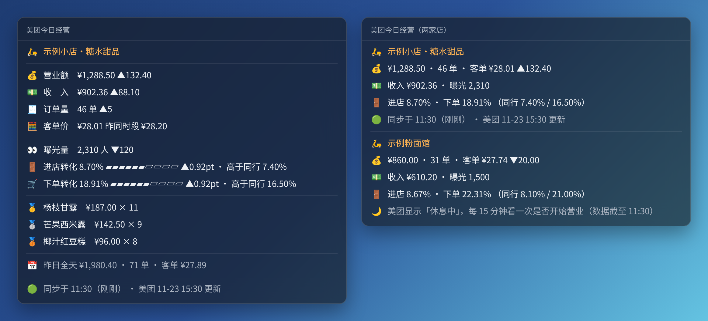
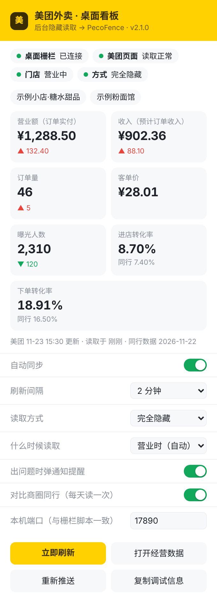
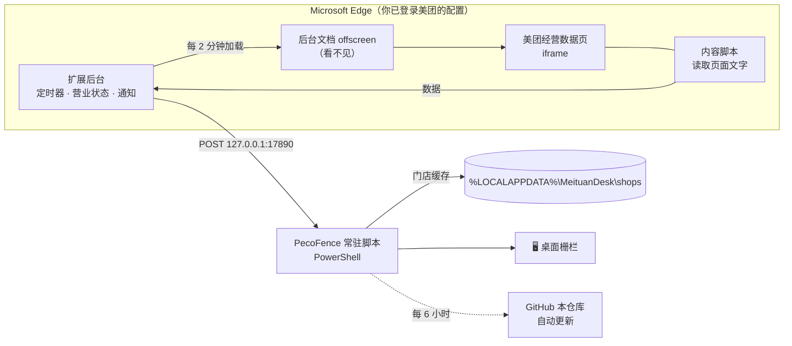

<div align="center">

# 🛵 美团外卖 · 桌面经营看板

**把美团外卖商家中心的「今日实时数据」放到 Windows 桌面上，自动刷新，不用一直开着后台网页。**

[](CHANGELOG.md)
[](LICENSE)




<sub>桌面栅栏效果预览。左：一家店的完整布局；右：两家店的紧凑布局，第二家店处于休息中。图中均为示例数据，实际外观取决于 PecoFence 的主题。</sub>

</div>

> [!IMPORTANT]
> 本项目**不是美团官方产品**，与美团没有任何关联。它只读取**你自己账号登录后、页面上已经显示的内容**，不调用美团的未公开接口，不修改任何店铺设置。读取商圈同行数据时，会在看不见的后台页面里点一下「流量」标签。请自行确认使用方式符合美团平台的规则，风险自负。

---

## 目录

- [功能](#-功能)
- [快速开始](#-快速开始)
- [界面说明](#-界面说明)
- [设置](#-设置)
- [多门店](#-多门店)
- [自动更新](#-自动更新)
- [工作原理](#-工作原理)
- [权限与隐私](#-权限与隐私)
- [常见问题](#-常见问题)
- [其他版本](#-其他版本)
- [更新记录](#-更新记录)
- [致谢](#-致谢)

---

## ✨ 功能

**数据**
- 💰 营业额（订单实付）、收入（预计订单收入）、订单量、客单价，每项都和**昨日同时段**比较
- 👀 曝光人数、进店转化率、下单转化率，带进度条和百分点变化
- 📊 **对比商圈同行**：转化率旁边标出「高于 / 低于同行」（每天读一次美团「流量」页的商圈同行均值）
- 🥇 实时热销前三，📅 昨日全天汇总

**省心**
- 🙈 **完全隐藏读取**：在 Edge 扩展的后台文档里加载页面，没有标签页，没有窗口，任务栏上也看不到
- 🌙 **自动识别营业状态**：读美团顶部的「营业中 / 休息中」，休息时只每 15 分钟看一次，开始营业后自动恢复每 2 分钟刷新
- 🔔 **出问题就提醒**：美团登录失效、读不到数据、桌面栅栏没在运行时，Windows 右下角弹通知，点一下就能处理
- 🔄 **自动更新**：定期检查本仓库，有新版就自动下载替换，扩展跟着自动重新加载
- 🏪 **多门店**：多个账号的店汇总到一个栅栏，或者每家店单独一个栅栏

**轻量**
- 不需要安装 Python、Node 或任何运行库，只用 Windows 自带的 PowerShell 5.1
- 数据只在本机流转（Edge → `127.0.0.1` → 桌面），不经过任何服务器

---

## 🚀 快速开始

**需要：** Windows 10 / 11、Microsoft Edge、[PecoFence](https://pecofence.jiang.jp/)

1. **下载**：点本页右上方绿色的 **Code → Download ZIP**，解压后把整个文件夹放到一个固定位置（例如 `D:\Tools\meituan-pecofence`），之后不要移动或删除它。
   > `edge-extension` 和 `pecofence` 两个文件夹要保持在同一个上级文件夹里，自动更新靠这个结构找到它们。
2. **装扩展**：Edge 地址栏打开 `edge://extensions` → 打开左下角「开发人员模式」→「加载解压缩的扩展」→ 选择 `edge-extension` 文件夹。
3. **登录美团**：在这个 Edge 里登录 [美团外卖商家中心](https://waimaie.meituan.com/)。
4. **建栅栏**：PecoFence 托盘菜单 → 新建小工具 → **用自己的脚本…** → 选择 `pecofence\美团今日经营.ps1`。
5. **（建议）让 Edge 在后台运行**：打开 `edge://settings/system`，开启「关闭 Microsoft Edge 后继续运行后台扩展和应用」。这样关掉所有 Edge 窗口后，数据也会继续更新。

十几秒后，栅栏上就会出现今天的数据。

---

## 🖥 界面说明

### 桌面栅栏

| 行 | 含义 |
|---|---|
| 📌 今日 | 设置了 `$Plan` 才显示：当天要做的事，悬停看细节 |
| 🛵 店名 | 点击打开美团经营数据页。鼠标悬停可以看到门店 ID 和看板版本 |
| 💰 营业额 | 订单实付：顾客实际支付的合计。▲▼ 表示比昨日同时段多了或少了多少 |
| 💵 收入 | 预计订单收入：扣除平台服务费、配送费和活动补贴后的商家收入 |
| 🧾 订单量 / 🧮 客单价 | 客单价 = 订单实付 ÷ 订单量，旁边附昨日同时段的客单价 |
| 🎯 目标 | 设置了 `$GoalIncome` / `$GoalOrders` 才显示：收入完成百分比、还差多少钱、单量进度，达成后变成 ✅ |
| 👀 曝光量 | 曝光人数 |
| 🚪 进店转化 | 入店人数 ÷ 曝光人数。进度条满格为 15%，`pt` 表示百分点变化 |
| 🛒 下单转化 | 下单人数 ÷ 入店人数（算法与美团「流量转化」页一致），进度条满格为 30% |
| 🥇🥈🥉 | 实时销售榜前三（只有一家店时显示） |
| 📅 昨日全天 | 「历史收益概览」里昨日的实付、单量、客单价。悬停可以看收入和补贴 |

**最后一行是状态：**

| 状态 | 含义 | 你需要做什么 |
|---|---|---|
| 🟢 同步于 HH:MM | 正常 | 不用管 |
| 🌙 美团显示「休息中」 | 门店休息中，每 15 分钟看一次是否开始营业 | 不用管 |
| 🟠 已 N 分钟没有同步 | 一段时间没收到数据 | 确认 Edge 在运行；点这一行可以打开美团页面看看 |
| 🟠 Edge 没在运行 | Edge 已完全退出 | 点这一行，会在后台启动 Edge（不弹窗口） |
| 🔴 美团登录已失效 | 需要重新登录 | 点这一行，在 Edge 里登录 |
| 🧩 Edge 扩展还是旧版 | 自动更新后，扩展没有自动重新加载 | 打开 `edge://extensions`，点扩展的「重新加载」 |
| 🔄 已更新，正在重新启动 | 刚完成自动更新 | 不用管，PecoFence 会自动重新运行新版本 |

### 扩展弹窗

点 Edge 工具栏上黄色的图标：



最上面一排状态灯依次表示：桌面栅栏有没有在运行、美团页面读取是否正常、门店当前的营业状态、正在用哪种读取方式。

---

## ⚙ 设置

### 扩展设置（扩展弹窗里）

| 设置 | 默认 | 说明 |
|---|---|---|
| 自动同步 | 开 | 关掉后完全停止读取 |
| 刷新间隔 | 2 分钟 | 营业中时多久读一次 |
| 读取方式 | 完全隐藏 | 「完全隐藏」不开任何窗口；「最小化小窗口」只在隐藏方式读不到数据时手动选用，且始终只开 1 个窗口 |
| 什么时候读取 | 营业时（自动） | **营业时（自动）**：跟随美团的营业状态；**固定时间段**：自己设开始和结束时间，支持跨午夜，比如 09:00–02:00；**一直读取** |
| 出问题时弹通知提醒 | 开 | 登录失效、读取失败、栅栏没运行时弹 Windows 通知。同类通知最多 1–2 小时提醒一次 |
| 对比商圈同行 | 开 | 每天读一次美团「流量」页的商圈同行均值 |
| 本机端口 | 17890 | 要和栅栏脚本的 `$Port` 一致 |

### 栅栏设置（`pecofence\设置.ps1`）

第一次运行栅栏时会自动生成这个文件，**自动更新不会覆盖它**。去掉行首的 `#` 就会生效，改完后在 PecoFence 里重启栅栏。

| 变量 | 默认 | 说明 |
|---|---|---|
| `$TitleOverride` | 空 | 只显示一家店时，用这个代替美团上较长的店名 |
| `$StaleMinutes` | `8` | 超过多少分钟没收到数据就提示 |
| `$ShowTop` / `$ShowYday` / `$ShowPeer` | `$true` | 是否显示热销前三、昨日全天、商圈同行 |
| `$EntryBarMax` / `$OrderBarMax` | `0.15` / `0.30` | 进度条满格对应的转化率 |
| `$BarOn` / `$BarOff` | `▰` / `▱` | 进度条字符。如果显示成方框，改成 `'■'` / `'□'` |
| `$Port` | `17890` | 本机端口 |
| `$AutoUpdate` | `$true` | 是否自动从 GitHub 更新 |
| `$GoalIncome` / `$GoalOrders` | `0` / `0` | 今日美团收入目标（元）和单量目标。填了就显示 🎯 目标行，`0` 表示不显示 |
| `$GoalNote` | 空 | 目标行的悬停说明，例如 `'10月日均收入 920'` |
| `$Plan` | 空 | 每日任务，例如 `@{ '2026-11-24' = '今天要做的事'; '2026-11-25' = @('要做的事', '悬停显示的细节') }`。当天有任务时，栅栏最上面显示 📌 |
| `$PlanDayStart` | `5` | 凌晨几点前仍算前一天，营业到凌晨时用 |

---

## 🏪 多门店

| 你的情况 | 做法 |
|---|---|
| **不同账号的几家店** | 每个账号用一个 Edge 配置（右上角头像 →「添加个人资料」）。每个配置里都装一次扩展、登录对应账号。所有店会显示在同一个栅栏里，按店分开 |
| **想每家店单独一个栅栏** | 把 `美团今日经营.ps1` 复制一份，改名为 `美团今日经营-店名关键字.ps1`（例如 `美团今日经营-粉面.ps1`），再用它新建栅栏。自动更新时这些副本也会一起更新 |
| **同一个账号下有好几家店** | 目前只读取商家中心当前选中的那家店 |

几个栅栏同时运行时，第一个启动的负责接收数据，其余的读取共享缓存。负责接收的那个关掉后，其他栅栏会在 15 秒内自动接手。

> 电脑重启后，如果某个配置的店不更新了，打开一次那个配置的 Edge 窗口就行。之后关掉窗口，它也会在后台继续运行。

---

## 🔄 自动更新

```text
栅栏启动 20 秒后检查一次，之后每 6 小时检查一次
  └─ 读取本仓库 main 分支的 edge-extension/manifest.json，比较版本号
       └─ 有新版 → 下载仓库 zip → 替换 pecofence\美团今日经营*.ps1 和 edge-extension\
            ├─ 栅栏：退出，由 PecoFence 自动重新运行新版本
            └─ 扩展：下一次定时检查时发现文件版本变了，自动重新加载
```

- 你的 `设置.ps1` 和扩展弹窗里的设置都不会被覆盖。
- 需要电脑能访问 GitHub（`raw.githubusercontent.com`、`github.com`）。连不上时，栅栏会在店名行的悬停提示里显示「检查更新失败」，其他功能不受影响。
- 不想自动更新：在 `设置.ps1` 里写 `$AutoUpdate = $false`。

---

## 🔧 工作原理



- **隐藏加载**：扩展用 `chrome.offscreen` 创建一个看不见的文档，在里面用 iframe 打开经营数据页。美团的页面默认禁止被嵌入，扩展用一条 `declarativeNetRequest` 会话规则，去掉 `X-Frame-Options` 和 CSP 响应头。这条规则**只对不属于任何标签页的请求生效**（`tabIds: [TAB_ID_NONE]`），不影响你正常浏览。
- **读取数据**：内容脚本按「预计订单收入」这类标签文字找到对应的指标卡片，取出数字，再用文字颜色判断涨跌（美团红色为涨、绿色为跌）。营业状态读自页面顶部。读商圈同行时，会点一下「流量」标签，读取「流量转化」里本店和同行的转化率。
- **推送**：扩展把数据 POST 到 `127.0.0.1:17890`。栅栏脚本只监听本机地址，只接受带 `X-Mt-Dash` 请求头、来自扩展的请求，网页发来的请求一律返回 403。
- **栅栏**：PecoFence 的常驻（`streamable`）脚本，每输出一次 `~~~` 就刷新整块栅栏。每行的格式是 `文字 | icon= color= href= tooltip=`，与 xbar / SwiftBar 的插件格式相近。

---

## 🔒 权限与隐私

| 扩展权限 | 用途 |
|---|---|
| `https://*.meituan.com/*` | 在美团商家中心页面里运行读取脚本 |
| `http://127.0.0.1/*` | 把数据推送给本机的桌面栅栏 |
| `offscreen` | 创建看不见的后台文档来加载页面 |
| `declarativeNetRequestWithHostAccess` | 只对后台文档里的美团页面去掉禁止嵌入的响应头 |
| `alarms` | 定时读取 |
| `storage` | 保存设置和最近一次的数据 |
| `tabs` | 清理旧版本留下的标签页和窗口；「最小化小窗口」模式需要用到 |
| `notifications` | 出问题时弹 Windows 通知 |
| `background` | 关掉 Edge 窗口后，扩展能继续在后台运行 |

- 所有数据只在你自己的电脑上：Edge → `127.0.0.1` → 桌面栅栏。不会上传到任何服务器。
- 扩展不读取、不保存你的美团密码，也不导出 Cookie。
- 门店缓存在 `%LOCALAPPDATA%\MeituanDesk\shops`。卸载时删掉这个文件夹即可。
- 提 Issue 附调试信息前，请先删掉里面的店铺数字，以及网址里的 `token=`、`bsid=` 这类参数。

---

## ❓ 常见问题

<details>
<summary><b>栅栏一直显示「等待数据」</b></summary>

1. 点 Edge 工具栏上的扩展图标，看「桌面栅栏」那一项是不是「已连接」。显示「未运行」的话，检查 PecoFence 里的栅栏有没有在运行。
2. 点「立即刷新」，等 10–20 秒。
3. 「美团页面」显示「需重新登录」的话，在 Edge 里重新登录美团。
</details>

<details>
<summary><b>扩展显示「隐藏读取失败」</b></summary>

美团页面在后台文档里没能正常加载。可以在扩展弹窗里把「读取方式」改成「最小化小窗口」先用着，然后点「复制调试信息」，删掉里面的店铺数字后提交 Issue。
</details>

<details>
<summary><b>关掉 Edge 后就不更新了</b></summary>

扩展需要 Edge 在运行，但不需要开着窗口。打开 `edge://settings/system`，开启「关闭 Microsoft Edge 后继续运行后台扩展和应用」。如果 Edge 被完全退出了，栅栏上会出现「Edge 没在运行，点此在后台启动」。
</details>

<details>
<summary><b>自动更新后栅栏提示「Edge 扩展还是旧版」</b></summary>

扩展没能自动重新加载。打开 `edge://extensions`，在「美团外卖 · 桌面经营看板」上点「重新加载」（圆形箭头图标）就行。
</details>

<details>
<summary><b>进度条显示成方框 / 文字乱码</b></summary>

进度条显示成方框：在 `设置.ps1` 里加一行 `$BarOn = '■'; $BarOff = '□'`。<br>
文字乱码：确认脚本文件是 UTF-8 BOM 编码。从本仓库下载的文件默认就是。
</details>

<details>
<summary><b>提示端口被占用</b></summary>

把 `设置.ps1` 里的 `$Port` 和扩展弹窗里的「本机端口」改成同一个新数字，比如 `17891`。
</details>

<details>
<summary><b>美团改版后读不到数据</b></summary>

在扩展弹窗里点「复制调试信息」，删掉店铺数字后提交 Issue。读取逻辑在 `edge-extension/content.js`，是按页面上的标签文字匹配的，一般只需要小改。
</details>

---

## 📦 其他版本

| 目录 | 说明 |
|---|---|
| `edge-extension/` + `pecofence/` | **推荐**。扩展版，本文档介绍的就是它 |
| `background-edge/` | 不需要装扩展：脚本自己在后台启动一个看不见的独立 Edge 来读取，需要单独登录一次（双击 `一键安装.cmd`）。不支持多门店、商圈同行和自动更新 |

---

## 📝 更新记录

见 [CHANGELOG.md](CHANGELOG.md)。

---

## 🙏 致谢

- [PecoFence](https://pecofence.jiang.jp/)：Windows 桌面栅栏，提供了脚本小工具和常驻（streamable）模式
- [xbar](https://github.com/matryer/xbar) / [SwiftBar](https://github.com/swiftbar/SwiftBar)：`文字 | 参数` 这种脚本输出格式的先行者

## 📄 许可

[MIT](LICENSE) © ningchoi-ops
